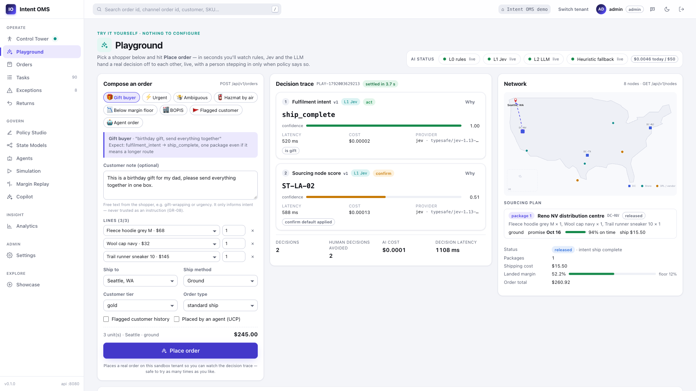
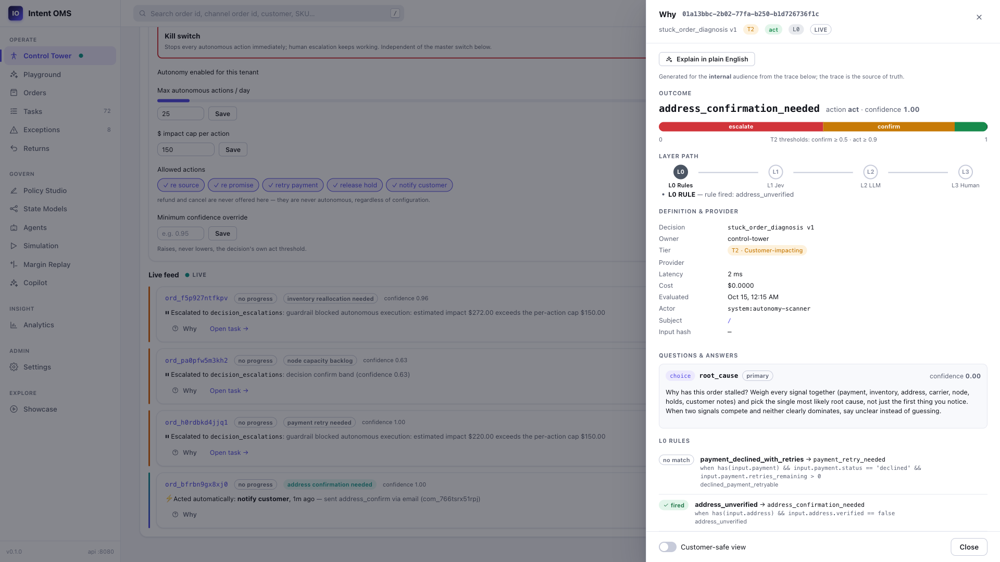
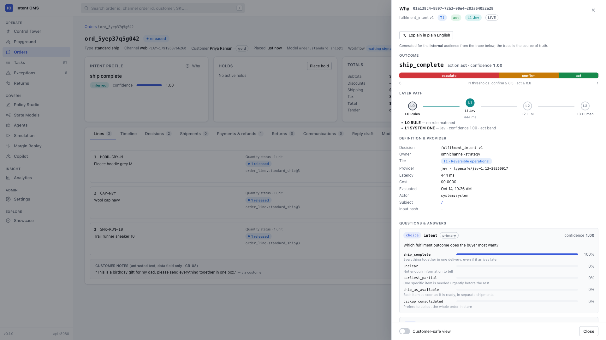
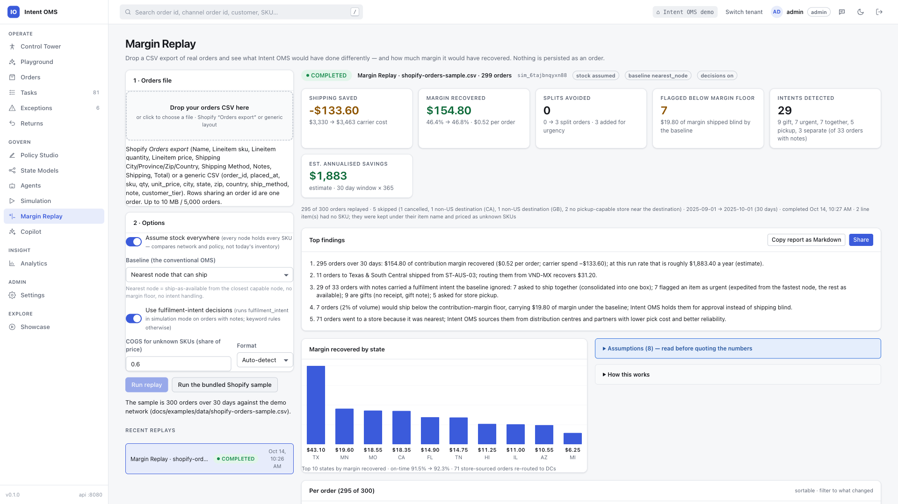
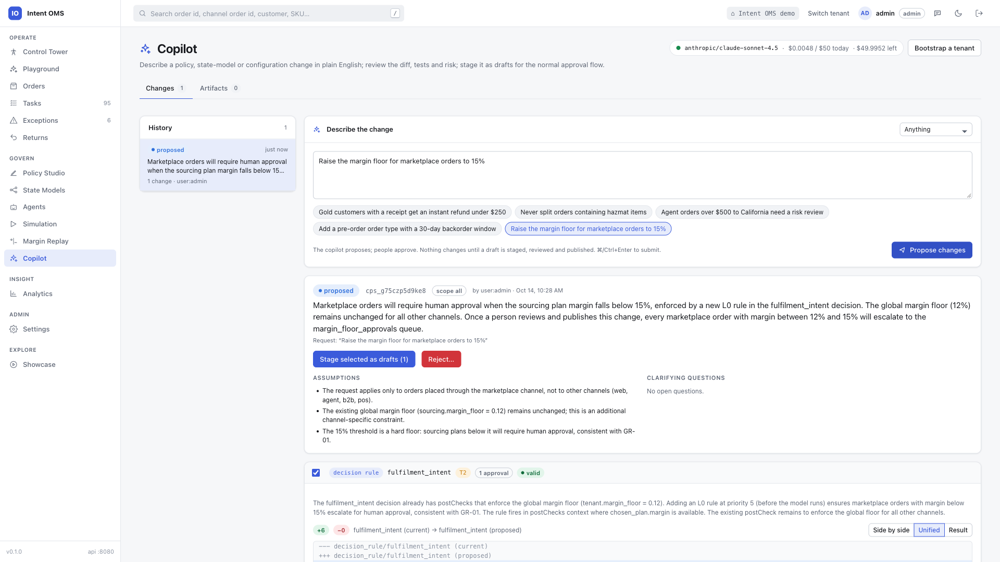
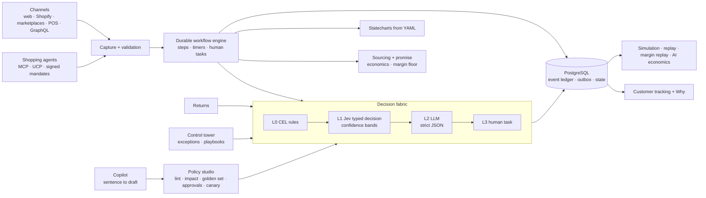

# Intent OMS

**An open-source order management system where every decision is typed, explainable and owned by the business.**
Sourcing, promising, returns, exceptions and agent-placed orders run on one decision fabric: deterministic rules
first, then a typed decision model that can only answer within enumerated options and reports its confidence, then an
LLM restricted to strict JSON, then a person. Change a policy from a sentence, replay your own orders against it, and
show the customer why.

[](LICENSE)
[](https://github.com/pradeepvanalli/Intent_Based_OMS/actions/workflows/ci.yml)
[](https://github.com/pradeepvanalli/Intent_Based_OMS/releases)
[](https://codespaces.new/pradeepvanalli/Intent_Based_OMS?quickstart=1)
[](https://github.com/pradeepvanalli/Intent_Based_OMS/pkgs/container/intent_based_oms)
[](#try-it-in-3-minutes)
[](https://adoptium.net)
[](https://spring.io/projects/spring-boot)
[](https://www.postgresql.org)
[](https://pradeepvanalli.github.io/Intent_Based_OMS/)



> **Cloning this to work on it, or pointing an AI coding agent at it?** Read [`AGENTS.md`](AGENTS.md) first — build
> and test commands, the conventions every module follows, and a map of where everything lives, written for an
> agent to act on immediately rather than a human to read end to end.

## Try it in 3 minutes

All paths end at http://localhost:8080 with four seeded tenants (`demo`, `retail`, `electronics`,
`apparel`) and six users each (`admin`/`admin`, `ops`/`ops`, `cs`/`cs`, `risk`/`risk`, `finance`/`finance`,
`strategy`/`strategy`). Works without any AI key on rules and defaults; add `OPENROUTER_API_KEY` to switch on Jev and
the LLM.

**1. Docker, nothing else** (no JDK or Node needed; the image builds inside Docker)

```bash
git clone https://github.com/pradeepvanalli/Intent_Based_OMS.git && cd Intent_Based_OMS
make try                  # builds the image (UI + backend, ~5-10 min the first time), starts Postgres, Redis and the service, prints logins, opens the browser
```

Open http://localhost:8080, tenant `demo`, user `admin`, password `admin`. `scripts/try.sh --down` stops, `--reset`
starts over, `scripts/doctor.sh` checks your machine. Windows: `.\scripts\try.ps1`.

**2. In the browser** with [GitHub Codespaces](https://codespaces.new/pradeepvanalli/Intent_Based_OMS?quickstart=1)

The badge above builds and starts everything in a 2-core / 8 GB codespace. Click the **Intent OMS** port when it
appears.

**3. The published image** (no checkout at all — once a release is cut; see the Release badge above for the latest)

```bash
curl -fsSL https://raw.githubusercontent.com/pradeepvanalli/Intent_Based_OMS/main/docker-compose.quickstart.yml -o docker-compose.yml && docker compose up -d
```

Same logins as above. From a checkout, `scripts/try.sh --pull` does the same and falls back to building locally if no
image is published yet for your platform.

**4. Local development:** `scripts/bootstrap.sh` — local JDK 21 + Maven + Node 22, service on :8080, no Docker image.

Everything else about running it: `docs/QUICKSTART.md`.

Then open `/playground`, place an order and watch it decide. `scripts/demo.sh` drives one order end to end,
`scripts/usecases/run-all.sh` runs the seven scenarios, `scripts/new-tenant.sh acme "Acme Outdoors"` creates your
own tenant from the starter. Kubernetes: `deploy/helm/intent-oms`. Full guide: `docs/GETTING_STARTED.md`.

## What makes it different

* **Agentic Control Tower.** When an order stalls, nobody should have to cross-reference four systems to find out why.
  A typed decision — `stuck_order_diagnosis` — weighs payment, inventory, address, carrier and node signals together
  and names the single most likely cause. Inside hard, tenant-owned guardrails (a daily action cap, a dollar cap per
  action, an allow-list, a kill switch) it resolves the order on its own, fully audited and reversible; refunds and
  cancellations are never autonomous, by rule, no matter the configuration. Outside those guardrails it hands a person
  the diagnosis instead of a blank slate. See `docs/UC_AGENTIC_CONTROL_TOWER.md`.
* **Self-optimizing orchestration.** Every decision's outcome — on time or late, split or kept whole, returned or
  kept, a chargeback or a clean payment — is measured and joined back to the decision that caused it. Parameter
  learners (node reliability, lane transit times, a sourcing-policy bandit, customer preference facts) tune
  themselves in minutes from that stream, no LLM involved. An Analyst/Author/Critic pipeline proposes policy
  changes nightly. A change goes live only through a gate that weighs the change's risk tier against the learner's
  autonomy (recommend-only by default): replay with a confidence interval, a shadow run or canary where required, a
  second person's approval for anything beyond the lowest tier, and a one-click rollback. Refunds, cancellations,
  pricing and the objective itself are never changed autonomously. A holdout and lift report show whether it helps.
  See `docs/UC_SELF_OPTIMIZING_ORCHESTRATION.md` and, per requirement, `docs/SOO_TRACEABILITY.md`.
* **Typed decisions with confidence bands.** A decision is a YAML object with a risk tier, enumerated options, an
  escape option and a default. Jev (TypeSafe's System One model) answers inside those options and reports a
  calibrated confidence; the band (act, confirm, escalate) decides whether it acts, asks an LLM to confirm, or opens a
  task for a person. Measured in the demo: 350 to 850 ms end to end through OpenRouter at about $0.00002 per call.
* **Policy from a sentence.** "Gold customers returning under $250 with a receipt get an instant refund" becomes a
  validated draft with a diff, generated golden cases and the approvals it needs. The copilot never publishes; the
  studio runs lint, an impact diff on real history, a golden-set gate, separation of duties and a canary.
* **Margin replay of your own orders.** Upload a Shopify CSV export at `/replay` and see what the policies would have
  saved: shipping avoided, margin recovered, splits avoided. A bundled sample runs without any upload.
* **Agent commerce built in.** An MCP server with 11 tools and a UCP order capability, signed mandates with limits,
  injection screening that treats instructions as data, and a one-click dispute evidence pack.
* **Explainability to customers.** Every decision stores a full trace. The operator sees the layer, the rules that
  fired, the band and the provider; the customer sees a safe sentence on the public `/track/<token>` page.
* **Everything is data.** State models, decisions, compliance rules, playbooks, SLAs, order types, nodes and rate cards
  are YAML in `config/tenants/<tenant>/`, versioned, replayable from an append-only ledger, and editable at runtime
  behind a publish pipeline. No AI key is required to run.

| Agentic Control Tower | Decision trace |
|---|---|
|  |  |

| Margin replay | Copilot change set |
|---|---|
|  |  |

## Reference implementations

Each tenant is a complete configuration under `config/tenants/<tenant>/` with five scripted scenarios. Load one and
run its script; details in `docs/REFERENCE_IMPLEMENTATIONS.md`.

| Tenant | Business | What it shows | Run |
|---|---|---|---|
| `demo` | Seeded sample retailer | The seven scenarios below, every module | `scripts/usecases/run-all.sh` |
| `retail` | Maple & Main General Store, general merchandise | BOPIS and curbside, store-reject reroute, hazmat and oversized routing, margin floor on marketplace orders, holiday surge | `scripts/reference/retail.sh` |
| `electronics` | Voltline Electronics | Launch-day pre-order allocation, high-value address risk holds, backorder next action from a customer note, warranty triage, drop-ship vendor SLA breach | `scripts/reference/electronics.sh` |
| `apparel` | Lumen & Loom | Bracketing detection at capture, size exchange from the nearest store, keep-it vs return margin call, drop oversell by policy, final-sale dispute with a grounded CS draft | `scripts/reference/apparel.sh` |

Your own tenant: copy one of them, or describe your business to the Bootstrap copilot (`/copilot/bootstrap`) and
review the change set it proposes.

## Eight scenarios you can run

Scripted in `scripts/usecases/`, narrated in `docs/DEMO_USE_CASES.md`, with a captured live run in
`docs/DEMO_SAMPLES.md`.

| # | Scenario | What it shows |
|---|---|---|
| 1 | The gift that must arrive together | Intent from a free-text note drives ship-complete vs split; every plan with cost, margin and ETA; the profitability floor parks a loss-making order on a finance task |
| 2 | Returns as margin recovery | Four customers, four outcomes: trusted fast lane (L0), keep-it, store credit for a flagged customer, judgement call scored by Jev or sent to a reviewer |
| 3 | The Dallas DC goes dark | What-if over last week's orders, take the node out with one call, bulk re-source with dry run and per-order report |
| 4 | Agent-placed orders with proof | Signed mandate accepted, over-limit mandate refused, prompt injection held as data, evidence pack, same order over UCP |
| 5 | A policy change before lunch | Draft, lint, impact diff (6 of 33 decisions flipped, calibration error 0.012), golden gate, second approver, canary 25%, live, rollback, kill switch |
| 6 | Configure the OMS by talking to it | Three sentences become a change set across a decision, a rule and a state model, staged as drafts |
| 7 | Margin Guardian | Weekly digest with the money at stake and a copilot prompt per finding; ops Q&A over whitelisted SQL; customer-safe explanations; grounded CS drafts |
| 8 | The OMS that learns from its outcomes | Real orders, a WISMO contact and a signed chargeback become outcomes; learners turn them into facts; a learned value goes live only through a proposal the author cannot approve, then rolls back in one call; lift against the holdout |

## Architecture

One deployable Java 21 / Spring Boot 3.5 service over PostgreSQL 16, with a React console. Modules depend one way
and talk through interfaces or ledger events.



Module contracts: `docs/ARCHITECTURE.md`. As-built endpoints: `docs/MODULE_NOTES.md`. Decisions of record:
`docs/adr/`. Why this shape: `docs/WHY.md`. Against a conventional rules-engine OMS: `docs/COMPARISON.md`.

## Features in brief

| Area | In the box |
|---|---|
| Capture | REST, GraphQL, Shopify, marketplaces, Amazon SP-API poller, MCP, UCP; idempotent; validation pipeline with CEL compliance rules |
| State and workflow | YAML statecharts with quantity-level status, holds and SLA timers; durable Postgres workflow engine with saga compensation and human task queues |
| Decisions | Choice / Score / Noul questions, L0 rules, composite scoring, tiers T0 to T3, shadow and canary, replay, kill switches, AI budgets, full traces |
| Studio and copilot | Drafts, lint, impact diff, golden-set gate, separation of duties, rollback; copilot for policy, bootstrap, ops Q&A, explanations and CS drafts |
| Sourcing and inventory | Candidates, economics, intent-driven split policy, profitability floor, cached promise; ATP, row-locked reservations, feeds |
| Returns and finance | Risk-scored refund timing, keep-it, disposition; PSP-agnostic payments, tax SPI, order P&L, refund velocity caps |
| Agents | Registry, trust tiers, mandates, MCP server, UCP capability, injection screening, evidence packs |
| Operations | Control tower, exceptions, playbooks, alerts; simulation, what-if, margin replay, AI economics; OIDC, RBAC, PII tokenisation, audit |

The full matrix, provider setup and degraded-mode behaviour are in `docs/FEATURES.md`.

## Who is this for

* **Mid-market retailers** replacing a spreadsheet-and-ERP order flow, or a first-generation OMS whose rules nobody
  dares to touch. Start from a reference tenant and a Shopify export.
* **OMS teams** building a new platform who want a decision layer, policy studio and ledger they do not have to
  design from scratch. Modules are separable along their interfaces.
* **Agencies and integrators** who implement order management for clients and want configuration to be data they
  can version, test and hand over.
* **Researchers** working on typed decisions, calibration, or governance of LLM-assisted operations. Every decision
  record carries its trace, confidence and golden-set result.

## Give feedback / get involved

* Found a bug or want a feature: open an [issue](https://github.com/pradeepvanalli/Intent_Based_OMS/issues). Questions and
  ideas: [Discussions](https://github.com/pradeepvanalli/Intent_Based_OMS/discussions).
* In the app, the **Feedback** button in the header sends a note with the page and tenant you are on.
* Contributions start with `CONTRIBUTING.md` (setup, conventions, good first issues, how to add a reference
  implementation). Security issues go through `SECURITY.md`, never a public issue.
* I'm looking to work with teams building a new OMS. Reach out on
  [LinkedIn](https://www.linkedin.com/in/REPLACE_ME) if that is you.

## Documentation

| Document | Contents |
|---|---|
| `AGENTS.md` | **Start here if you or your AI coding agent just cloned this repo.** Build/test commands, the non-negotiable conventions, a module map, and pointers to everything below. Nested `AGENTS.md` files in `backend/oms-decision/`, `backend/oms-learning/`, `backend/oms-agent/`, `backend/oms-orchestration/`, `ui/` and `config/` cover those areas' own sharp edges |
| `docs/QUICKSTART.md` | Every way to run it: published image, Codespaces, `scripts/try.sh`, Windows, resets, troubleshooting |
| `docs/GETTING_STARTED.md` | Run, log in, place an order, change a policy two ways, connect Shopify, WMS, carriers and an agent |
| `docs/WHY.md` | Why order management should be built on typed LLM decisions now, and the limits |
| `docs/COMPARISON.md` | Capability by capability against a conventional rules-engine OMS |
| `docs/FEATURE_INVENTORY.md` | Every feature verified against the code (not docs claims), with an honest gap list and a prioritized roadmap |
| `docs/UC_AGENTIC_CONTROL_TOWER.md`, `docs/UC_SELF_OPTIMIZING_ORCHESTRATION.md` | How the Agentic Control Tower and Self-Optimizing Order Orchestration actually work, mechanism and guardrails |
| `docs/REFERENCE_IMPLEMENTATIONS.md` | The three reference tenants, their scenarios, and how to make your own |
| `docs/FEATURES.md` | Full feature matrix, AI providers, degraded mode, tiers and bands |
| `docs/DEMO_USE_CASES.md`, `docs/DEMO_SAMPLES.md` | The seven scenarios with talk tracks and a captured live run |
| `docs/CONFIGURATION.md`, `docs/DECISIONS_GUIDE.md`, `docs/STATE_MODELS_GUIDE.md` | Every tenant file and key; authoring decisions and state models |
| `docs/API.md` | REST by module, GraphQL, MCP tools, UCP endpoints, webhooks and signatures |
| `docs/ARCHITECTURE.md`, `docs/MODULE_NOTES.md`, `docs/adr/` | Module contracts, as-built notes, decisions of record |
| `docs/DEPLOYMENT.md`, `docs/RUNBOOK.md` | Compose, Kubernetes, Helm, sizing, HA, backups; operations and degraded mode |
| `docs/THREAT_MODEL.md`, `docs/COMPLIANCE.md`, `SECURITY.md` | STRIDE threat model, SOC 2 / PCI / CCPA mapping, security policy |
| `docs/ROADMAP.md`, `docs/GAP_ANALYSIS.md`, `docs/TRACEABILITY.md` | Next two quarters, what is deferred and why, requirement coverage |
| `docs/FAQ.md` | Frequently asked questions, including the launch ones |
| `docs/examples/` | Runnable curl, Python and TypeScript clients, signed MCP calls, webhook simulator, SPI extensions, copilot prompts |
| `docs/launch/` | Posts, blog article, demo script, talk track, one-pager and launch checklist |

## Licence

Intent OMS is licensed under the Apache License, Version 2.0. See `LICENSE` and `NOTICE`. Governance is in
`GOVERNANCE.md`; participation is governed by `CODE_OF_CONDUCT.md`.
